# 米哈游三游 · 每日自动化（原神 / 崩铁 / 绝区零）

用**社区成熟工具当引擎**，加上一层我们自己的"胶水"：定时调度、屏幕模式自动切换、**集成配置中心**、
一键下载/启动三个工具。你日常只需要双击桌面上的「HoYo 配置中心」（或 `panel.bat`），其余到点自动跑完、自动关游戏。

## 目录

- 上手：[下载](#下载) · [更新日志](#更新日志最近的几步) · [30 秒排查](#30-秒排查今天没跑--跑失败--掉登录) · [快速开始](#快速开始)
- 界面：[配置中心（十页）](#配置中心桌面一键打开)
- 原理：[做了什么/没做什么](#这个项目做了什么以及没做什么) · [三个引擎](#三个引擎上游项目--版权归原作者遵循其各自许可证) · [日志判定的三层](#日志判定的三层不是退出码-0-就算成功) · [屏幕模式自动切换](#屏幕模式自动切换含自愈) · [登录兜底](#登录兜底掉登录时自动用账号密码登录绝不用手机验证码)
- 参考：[配置项](#配置configdaily_configyaml) · [定时任务](#定时任务无人值守的关键) · [环境变量](#环境变量可选用于自定义路径) · [逐日复盘](docs/INCIDENTS.md) · [风险与免责](#风险与免责)

## 下载

- 最新发布包（zip，含全部调度层代码与配置中心）：[Releases · latest](https://github.com/Cyrus0719/hoyo-daily-3in1/releases/latest)
  —— 这个链接**永远指向最新版**，具体版本号见右侧 Releases 栏或仓库顶部；不想下载也可以直接 clone 仓库用。
- 三个引擎不在仓库里，由配置中心从**各自官方 Releases** 下载并检查更新（BetterGI 跟最新版、它自己的自动更新也开着）

## 更新日志（最近的几步）

完整历史见 [Releases](https://github.com/Cyrus0719/hoyo-daily-3in1/releases)。挑最近几版说：

| 版本 | 时间 | 这一版解决什么 |
|---|---|---|
| **v1.7.0** | 2026-11-24 | **登录态自愈**：记录坏了先只清 `MIHOYOSDK_ADL*` 两个值（官方解法），引擎启动前**自己拉起游戏用账号密码登回来**（以「记录真的写回」为成功标准），兜底线程不再静默失明；只在记录真坏时才动手，绝不碰其它配置 |
| v1.6.0 | 2026-11-14 | 配置中心体验优化：长页面**页内目录**、切页**骨架屏**、**深色/浅色主题**、上游程序在跑时**顶部提醒**（它退出会写回配置）、**回滚前先备份当前内容**、中文标签覆盖（未翻译 233→44 个） |
| v1.5.0 | 2026-11-14 | 新增「**帮助与排查**」页：路径、日志、上游文档一键打开，8 条最常见故障的定位步骤；顶栏与侧栏加 **Star** 入口 |
| v1.4.0 | 2026-11-14 | **真下拉**（秘境 74 个按类型分组）、原神**每周秘境**（周一~周日各配秘境+队伍）、崩铁**33 个功能各一张卡**、绝区零**14 个功能各自的详细设置**（键名/默认值/枚举从源码解析） |
| v1.3.0 | 2026-11-14 | 下载源三层兜底与测速、只玩其中几个游戏、任务可调顺序、副本掉落与开放规则提示、**高级选项不再漏**（上游默认值合并视图） |
| v1.2.0 | 2026-11-14 | 工具页**检查更新**（已装 vs 上游最新）、全局下拉选项化、崩铁页 [object Object] 等一批 bug |
| v1.1.0 | 2026-11-14 | 集成**配置中心**（取代原来的小面板），覆盖三游全部原生配置 |

## 30 秒排查（今天没跑 / 跑失败 / 掉登录）

先看 `logs/daily.log` 最后几十行：每款游戏结束时都会写一行「执行结束 ok=True/False」和失败原因。
更细的路径、日志、上游文档在配置中心的「帮助与排查」页（一键打开，不用记路径）。

| 症状 | 先看什么 | 常见原因 |
|---|---|---|
| 今天完全没跑 | `logs/daily.log` 里有没有「[游戏] 开始」；`schtasks /Query /TN HoYoDaily` 看下次运行时间 | 开机太晚（默认要开机 **10 分钟**后才开跑）、上一趟还没结束、机器没开机 |
| 原神失败 | `tools/BetterGI/BetterGI/log/better-genshin-impact<日期>.log` | 战斗脚本没覆盖队伍里的角色（会站桩挨打）、秘境/地脉花设置、掉登录 |
| 崩铁失败 | `tools/March7thAssistant/logs/<日期>.log`、`logs/m7a_console.log` | 账号登录过期、分辨率不是 16:9、引擎 1 分钟内无声退出（已判失败并重试一次） |
| 绝区零失败 | `OneDragon-ref/log/log.txt`、`logs/zzz_cli.log` | 窗口没画面（后台模式被打开）、未配置账号密码、脚本暂停 |
| 掉登录 | `logs/adl_state.log`（每趟前后「记住的账号」长度）、`logs/login/*.png` | 见 [登录兜底](#登录兜底掉登录时自动用账号密码登录绝不用手机验证码) 与 [docs/INCIDENTS.md](docs/INCIDENTS.md) |
| 提示「分辨率不是 16:9」 | 游戏设成 1920×1080 窗口化；本项目的 `win_guard.py` 会自动拉窗口 | 手动改过窗口大小、DPI 缩放不是 100% |
| 改了配置没生效 | 配置中心底部「保存」；`config/daily_config.yaml` | 上游界面的优先级更高（见「谁说了算」）；上游程序正开着会写回旧配置 |

## 这个项目做了什么（以及没做什么）

**做的：**
- 一份 YAML 配置驱动三款游戏的每日流程（每日任务 + 清体力/电量 + 领奖励 + 关游戏）。
- Windows 计划任务每天定时无人值守执行：零点击、零 UAC（任务以最高权限注册，子进程直接继承权限）。
- 执行前后**自动切换屏幕模式**（游戏窗口化 1920×1080 → 跑完恢复你自己的全屏设置），跑完自动关闭游戏。
- **集成配置中心**（桌面快捷方式一键打开）：三款游戏的**全部原生配置** + 我们自己的配置，一个界面统一改；
  一键下载/更新三个上游工具、分别启动它们的图形界面、改每日时间、看日志、自动备份与回滚。
- 掉登录时**自动用账号密码登录**（绝不用手机验证码），三款游戏都覆盖 —— 见「登录兜底」一节。

**没做的（重要）：**
- **不含任何上游工具的代码或二进制**。本仓库只有我们自己的胶水代码；三个引擎由配置中心从各自官方 Releases 下载。
- 配置中心覆盖**全部原生配置字段**（自动按文件结构生成表单，带中文标签；另有原文编辑兜底），
  但**不替你决定**上游工具的行为：优先级仍然是「上游界面 > `config/daily_config.yaml`」，
  适配器只覆写它自己负责的键（详见「谁说了算」一节）。

## 三个引擎（上游项目 · 版权归原作者，遵循其各自许可证）

| 游戏 | 引擎 | 上游仓库 | 本项目的启动方式 |
|---|---|---|---|
| 原神 | BetterGI | https://github.com/babalae/better-genshin-impact | `tools/BetterGI/BetterGI/BetterGI.exe` |
| 崩铁 | March7thAssistant | https://github.com/moesnow/March7thAssistant | `tools/March7thAssistant/March7th Launcher.exe` |
| 绝区零 | OneDragon（ZenlessZoneZero-OneDragon） | https://github.com/OneDragon-Anything/ZenlessZoneZero-OneDragon | 配置中心「工具」页 / `one_dragon_launcher.bat` |

模型的来源同样取自各上游官方仓库。本项目只按官方发布物原样下载，不修改其内容。

## 快速开始

1. 装 Python 3.11+，在项目根目录建虚拟环境并安装依赖：

   ```bat
   py -3 -m venv .venv
   .venv\Scripts\python.exe -m pip install -r requirements.txt
   ```

2. 双击桌面上的「HoYo 配置中心」（等价于项目里的 `panel.bat`）—— 浏览器会自动打开
   http://127.0.0.1:8900（端口被占用会自动换；面板已在运行时不会重复启动，只再开一个标签页）。
3. 「工具」页每张卡会显示「已装版本 · 上游最新版本」和有没有新版 → 点 **下载安装 / 更新到最新**（未装过的机器第一次用）。
4. 「工具」页点每个引擎的 **单独启动**，用它们自己的界面完成**首次登录/初始化**（登录、分辨率、队伍等一次即可）。
5. 回「原神 / 崩铁 / 绝区零 / 定时与运行」页改配置 → 底部**保存**；每日时间保存时会同步到系统计划任务（需要管理员权限运行一次配置中心）。
6. 之后就不用管了：每天到点自动依次跑完三款游戏，自动关闭游戏，日志在 `logs/daily.log`。

## 配置中心（桌面一键打开）

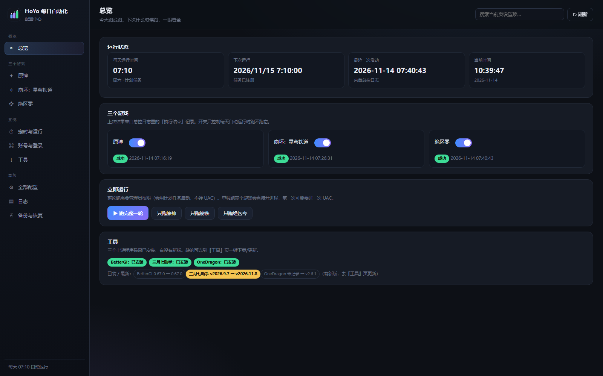

双击桌面上的 **HoYo 配置中心** 就会在浏览器里打开（本机 127.0.0.1，只有你能访问）。
一个界面里同时管三款游戏的全部配置 —— 上游工具的原生配置文件、我们自己的调度配置，用同一套交互：

| 页面 | 管什么 |
|---|---|
| **开始使用** | **新人引导**：只玩哪几个游戏、还差哪几步（装工具 / 填游戏路径 / 填账号 / 设时间 / 先手动跑一次），每步一句人话 + 「去处理」跳转 |
| 总览 | 今天跑没跑、下次什么时候跑、三款游戏的开/关、立即运行一次、工具是否已安装 |
| 原神 | BetterGI 一条龙的 **7 个任务可调顺序**（对应 `TaskOrder`）与开关、秘境与队伍（**74 个秘境真下拉**，附类型/开放规则/所在国家）、**每周秘境（周一到周日分别指定秘境+队伍）**、地脉花（时间/次数/花型/国家，周一~周日分别设）、自动首领讨伐 |
| 崩坏：星穹铁道 | 三月七助手：清体力计划（类型/副本名/次数，每行下面写**掉落与开放规则**）、常用设置、**33 个功能各一张卡**（模拟宇宙 13 项、货币战争 9 项、差分宇宙、历战余响、忘却之庭、虚构叙事、末日幻影…中文名取自上游注释） |
| 绝区零 | OneDragon 的账号、游戏与窗口、**一条龙功能清单可调顺序**、清电量计划（大类 → 类型 → 副本三级筛选 + 这一项给什么）、**14 个功能各自的详细设置**（键名/默认值/枚举直接从 OneDragon 源码解析） |
| 定时与运行 | 每天几点跑（**闹钟式选时选分** + 常用时间一点就好，自动同步到 Windows 计划任务）、运行顺序、超时、开机后等多久 |
| 账号与登录 | 掉登录时自动填的账号密码（打码显示，留空=不改）、每款游戏的自动登录/自动运行开关 |
| 工具 | 三个上游引擎的**检查更新**（已装版本 vs 上游最新版）、下载/更新/单独启动、**下载源可换可测速**（GitHub 直连 / 国内镜像 / 本机代理） |
| 全部配置 | **38 个配置文件**的完整表单 + 原文编辑（YAML 保留注释与键序，JSON 保持缩进） |
| 日志 | 总控日志、BetterGI、三月七、OneDragon 的日志实时查看（支持行数与关键字过滤） |
| 备份与恢复 | 每次保存自动生成的备份（标明属于哪个配置），一键回滚；**回滚前会先把当前内容也备份一份**，改错了还能再回来 |
| 帮助与排查 | 配置文件/日志/上游文档的**真实路径一键打开**、8 条常见故障的排查步骤、GitHub 与 Star 入口 |

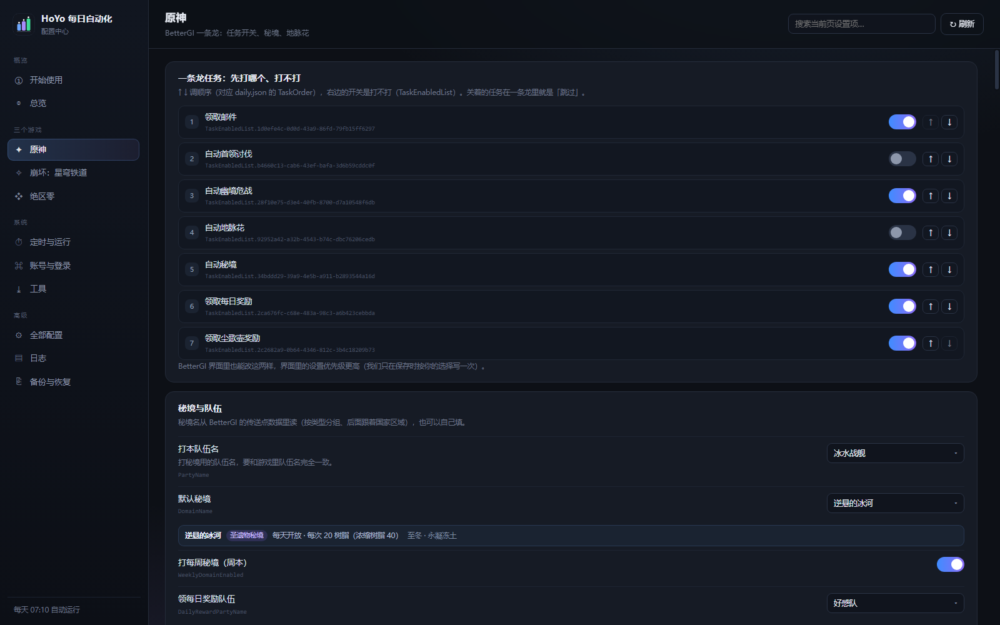

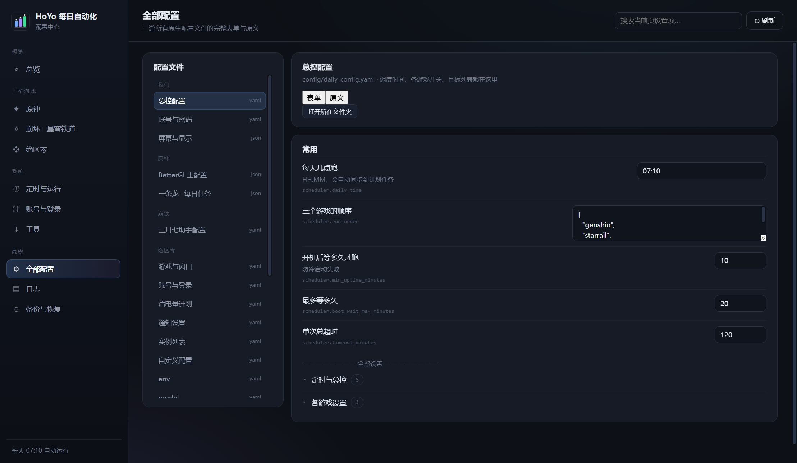

**统一的设置逻辑**（每个页面一致）：

- 改了任何一项，底部会出现「N 项未保存（M 个文件）」的保存条；点**保存**（或 `Ctrl+S`）才写盘。
- 写盘前自动备份到 `config/backup/<文件名>_<时间>.yaml`（最多保留 30 份），写盘是「写临时文件 + 原子改名」，
  不会出现写一半的坏配置。
- 保存后顶部给出结果提示；**有未保存的修改时关页面会拦一下**。
- 顶部搜索框可直接过滤当前页的字段（中英文都能搜）。
- 每个字段下面都标了它在配置文件里的真实路径，方便你对照原文。

**为什么能覆盖「全部原生配置」而不是几十个手写表单**：后端把每个 JSON/YAML 文件读成树，
按结构自动生成可折叠的分组表单（叶子节点=一个字段，类型决定控件：开关/数字/文本/下拉/数组），
再叠一层中文标签与重点说明；表单覆盖不到的地方，用「原文」页签直接改文件（保存前会做语法校验）。

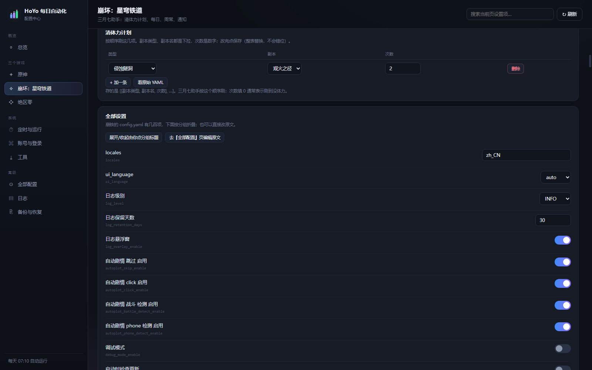

**该是下拉的地方就是下拉，选项不自己编**：凡是取值有固定集合的字段（副本名、地脉花国家与花型、
首领名、战斗策略、绝区零的一条龙功能/关卡/自动战斗配置、崩铁副本类型…），下拉选项都是后端**现读本机上游工具的数据文件**
（BetterGI 的 `tp.json`/`AutoBoss/Assets/Pathing/*.json`、三月七的 `instance_names.json`、绝区零的
`compendium_data.yml` 与源码枚举）生成的 —— 上游加了新副本，这里就自动多一条，不用改代码。
只有「队伍名」「秘境名」这类允许自己新建的值用「可输入的下拉」（输不在列表里的值也保留）。

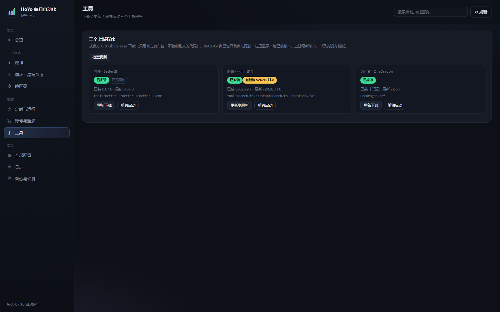

### 界面体验（2026-11-14 打磨）

对着八张截图和成熟配置软件的做法过了一遍，这一轮改的是「用起来顺不顺手」：

| 改进 | 具体做了什么 |
|---|---|
| **长页面有目录** | 顶上多了一条「本页 N 节」，点一下跳到对应卡片，滚动时会高亮当前所在的一节。原神页 9 节、崩铁页 5 节，不用再滚几十屏找设置 |
| **加载不再白屏** | 切页时先显示骨架屏（灰色占位块），而不是一行「读取中…」 |
| **深色 / 浅色** | 右上角 ◐ 一键切换，选择存在浏览器里，下次记住；浅色不是简单反色，顶栏、目录条、输入框、日志块都单独校过 |
| **上游在跑会提醒** | 打开某款游戏页时，如果发现对应的上游程序正在运行（BetterGI / 三月七 / 游戏本体），顶部给一条黄色提示：它退出时会把界面里的设置写回文件，可能盖掉你刚改的内容 —— 这是真实存在的行为，不是吓人 |
| **字号与对比度** | 正文字号从 13.5 调到 14，说明文字提亮，路径行加宽；卡片标题前加了一条渐变色条，扫读更快 |
| **中文标签更全** | 上游配置里原本一大片英文键名，现在**几乎每个字段都有中文名**：完全没翻译的字段从 233 个降到 44 个，剩下的都是上游内部键（如 `ProcessingCost`），故意不硬翻，免得翻错更难看 |
| **搜索 / 快捷键** | 顶部搜索框过滤当前页字段；`Ctrl+S` 保存，`/` 直接聚焦搜索框 |

浅色主题（总览页）：

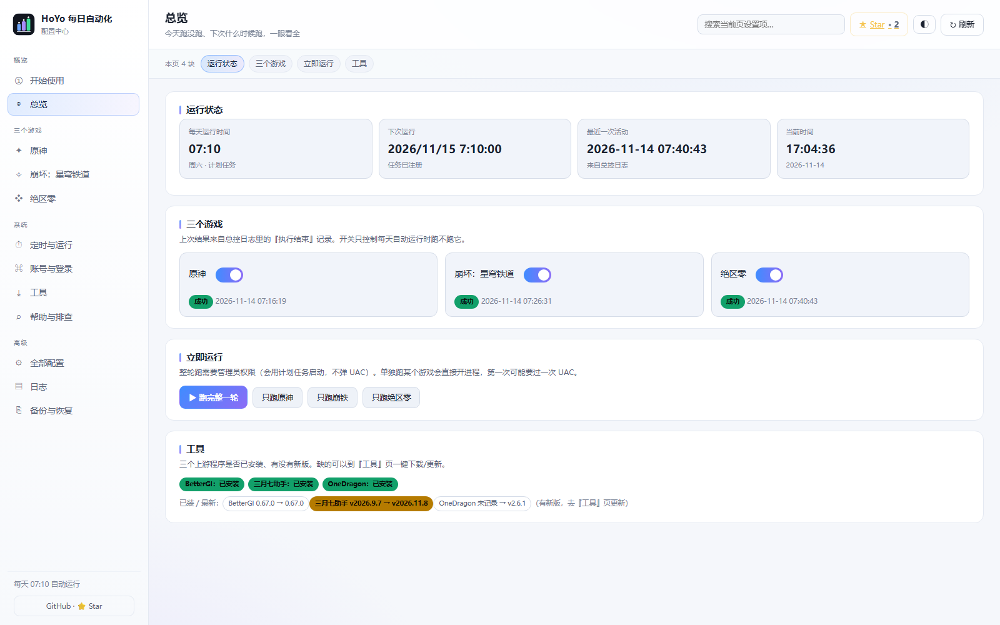

上游程序正在运行时，游戏页顶部会提醒「它退出时会写回配置」（下图用同名进程模拟的提示条）：

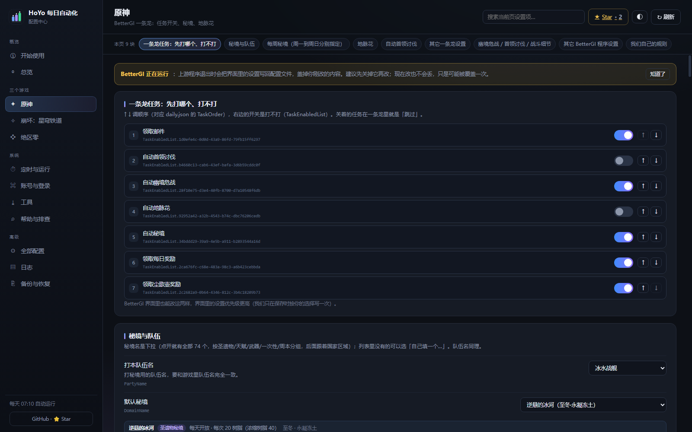

### 下载源：直连被卡就换一条路

三月七的完整包 450MB 起步，国内直连 GitHub Release 经常断在 90%（表现就是「更新失败」）。
工具页因此把下载拆成三层，并且**自动换源、断点续传**：

| 源 | 什么时候用 |
|---|---|
| GitHub 直连 | 官方地址，网络好的时候最快 |
| gh-proxy.com 国内镜像 | 国内可直连，实测比直连快一截 |
| 本机代理（`127.0.0.1:7897`） | 你自己开着 Clash / v2ray 一类代理时最快 |

- 「测速（各取 2MB）」会真的去拉一小段，把每条源的速度/失败原因写在行下面，然后把能跑的那条拖到第一位。
- 还可以填**自定义镜像前缀**（逗号分隔），程序会把它拼在官方地址前面。
- GitHub API 查版本同样走这三层 —— 不是只有下载才兜底。
- 三月七的包优先取 `.7z`（453MB）而不是 `.zip`（686MB），少下 230MB。

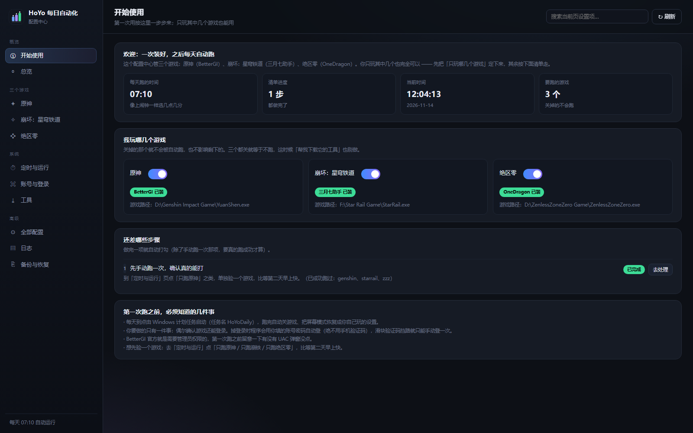

### 只玩其中几个游戏

「开始使用」页最上面就是三款游戏的总开关：关掉的那个**当天不会被跑**，也不影响剩下的，装不装它的工具都行。
三个都关就等于不自动跑 —— 页面会直接提示。

### 每天的任务可以自己排顺序

上游本来就支持调顺序，只是藏在配置文件里；现在都放到界面上（↑ ↓ 调，开关决定跑不跑，全表替换保存、不会错位）：

| 游戏 | 改的是哪个配置 |
|---|---|
| 原神 | `User/OneDragon/daily.json` 的 `TaskOrder`（7 个任务的 GUID 顺序）+ `TaskEnabledList` |
| 绝区零 | `config/01/one_dragon/_group.yml` 的 `app_list`（一条龙完整功能清单的顺序与开关） |
| 整轮调度 | `config/daily_config.yaml` 的 `scheduler.run_order`（谁先跑 —— 串行，前一个卡住决定后面还能不能赶上） |

### 副本详情就写在选择框下面

选副本的时候最烦的是"不知道这一项到底给什么、什么时候开"：

- **崩铁**：读三月七自带的 `assets/config/instance_drops.json`，每行下面直接写「掉落 回忆之蕾 → 漫游指南 · 常驻开放 · 每次 40 开拓力」。
- **原神**：读 BetterGI 的 `tp.json`，写秘境类型（圣遗物 / 天赋 / 武器 / 周本 / 一次性）、开放规则与所在国家区域。
  原神官方没有把套装掉落写进任何本地数据，所以**只给类型和开放规则，不编套装名**。
- **绝区零**：读 OneDragon 的 `compendium_data.yml`，副本名按「大类 → 类型 → 副本」三级筛选后，下面写这一项给什么（例如「给：特训目标」）。

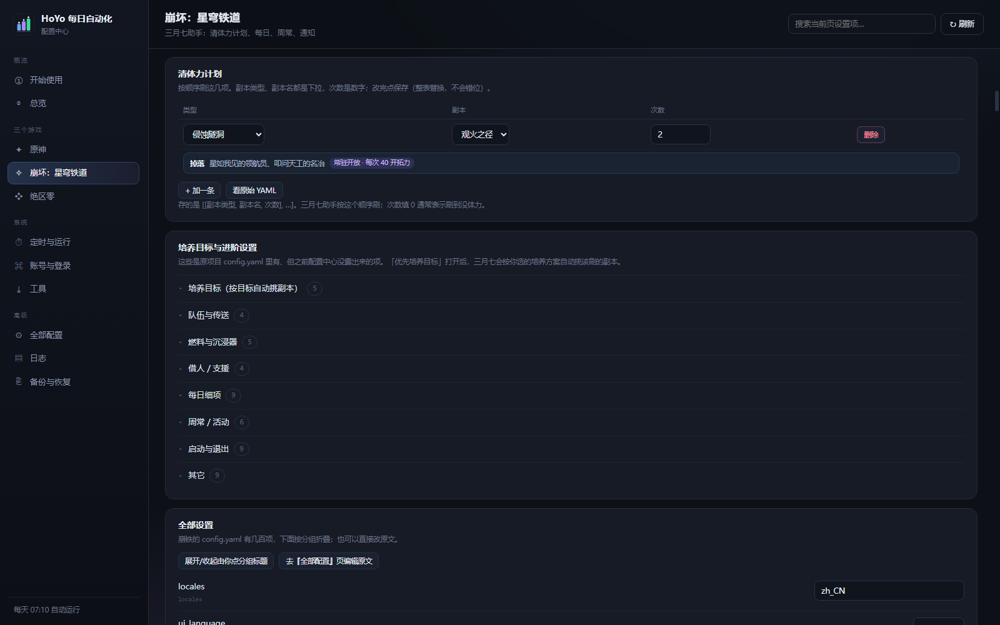

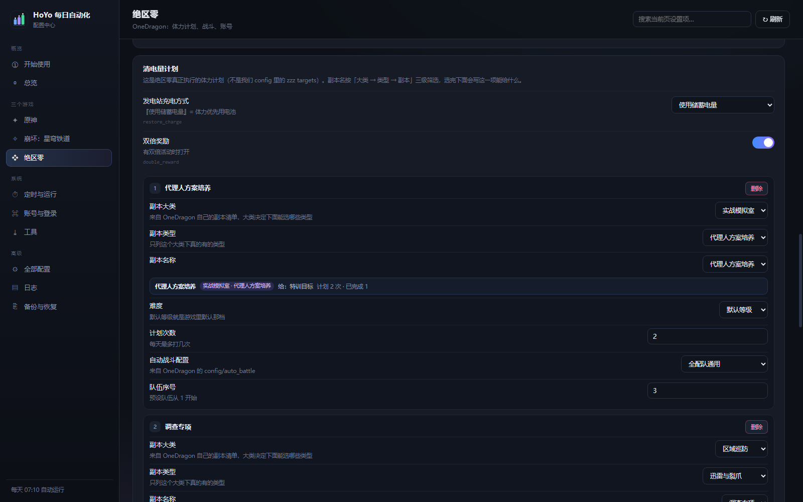

### 下拉是真的下拉（2026-11-14 重做）

以前那些"下拉"其实是 `<input list=datalist>` 加一个画出来的小箭头：点箭头什么都不弹，只能自己打字 —— 假的。现在：

- 全部换成真 `<select>`：点开就是完整选项，按 `optgroup` 分组；最后一行是「✎ 自己填一个…」，选了就切成输入框。
- **原神圣遗物副本**现在真的能选：圣遗物秘境 22 / 天赋秘境 8 / 武器秘境 8 / 一次性秘境 23 / 周本 13，共 74 个，按类分组，
  每一个后面还跟着开放规则（如「每天开放 · 每次 20 树脂」）。
- **队伍名**：程序能读到的队伍（`daily.json` 里的 `PartyName` / `*PartyName` / `*TeamName`、我们自己的配置）列出来直接选；
  游戏内的配队名不会存进任何本地文件，读不到就点「自己填一个…」。

### 原神的「每周秘境」：周一到周日分别指定

这就是 BetterGI 一条龙里的「打每周秘境」（`daily.json` 的 `WeeklyDomainEnabled` + `{Monday..Sunday}DomainName` + `{Day}PartyName`）。
界面是一张 7 行表：**周几 | 秘境 | 队伍**，某天选「（不打）」就是那天不打秘境。打开开关后一条龙按当天是周几去打对应秘境。

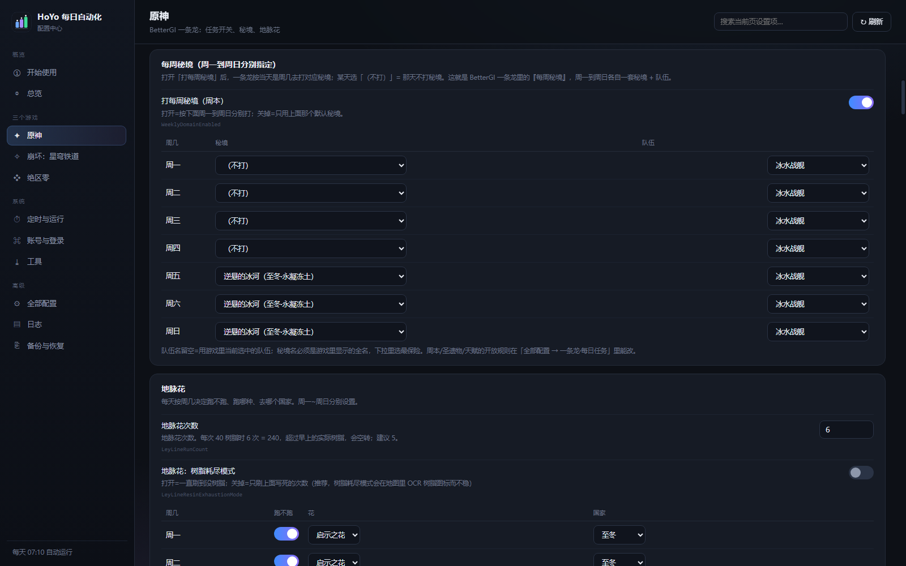

### 崩铁：33 个功能各一张卡，卡里是它自己的全部设置

上游 `config.yaml` 有 323 个键，以前只能看到"最常用的几项"。现在按上游自己的功能前缀分成 **33 组**，
每组一张可折叠的卡（标题带「已启用 / 未启用」和项数），点开就是这一项的全部设置：

| 功能 | 项数 | 功能 | 项数 |
|---|---|---|---|
| 清体力：体力与燃料 | 4 | 模拟宇宙 | 13 |
| 培养目标 | 5 | 差分宇宙（周常） | 6 |
| 副本与队伍 | 6 | 货币战争 | 9 |
| 每日实训 / 奖励领取 | 6 / 10 | 历战余响 / 忘却之庭 / 虚构叙事 / 末日幻影 | 3 / 5 / 5 / 5 |
| 战斗细节 | 12 | 活动 / 养成材料 / 借用支援 | 7 / 10 / 4 |
| 自动剧情 / 云游戏 / 浏览器 | 4 / 5 / 9 | 启动器 / 游戏进程 / 更新 | 3 / 4 / 6 |
| 自动化开关 / 体力使用 | 4 / 3 | 快捷键 / 窗口 / 日志 | 7 / 6 / 3 |
| 定时运行 / 通知 / 遥测 / 帧率解锁 | 6 / 112 / 3 / 2 | | |

字段的**中文名和说明不靠手写**：直接取上游 `assets/config/config.example.yaml` 里每个键后面的中文注释
（302 个键），所以模拟宇宙、货币战争的每一项都是中文并且带"true 开启，false 关闭"这类原话提示。

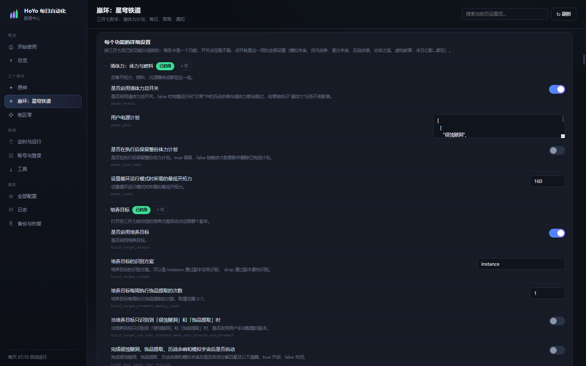

### 绝区零：每个功能一份自己的配置，默认值也从源码里取

OneDragon 的每个功能是 `config/01/one_dragon/<功能>.yml`，而文件里**只写改过的键** —— 所以以前界面看着像"没设置"。
现在 `config_center/od_schema.py` 直接正则解析 OneDragon 源码 `src/**/*_config.py`：`@property` 的键名、`self.get(key, 默认值)` 的默认值、
枚举类的取值、docstring 里的中文说明，全都读出来。于是：

- **14 个功能**都能展开改全部设置：每日签到 / 情报板 / 生活在线（咖啡店·刮刮卡）/ 迷失之地 / 恶名狩猎 / 枯萎之都 /
  战斗助手 / 咖啡店 / 委托助手 / 驱动盘分解 / 式舆防卫战 / 随便观 / 大世界巡查 / 零号空洞。
- 还没生成过 yml 的功能也列出来（改写才会落盘），字段名是中文、枚举是下拉、每个字段下面写着源码里的原话说明。
- 体力计划（`charge_plan`）仍然在上面那张「清电量计划」卡里按副本一条条编辑，这里不重复。

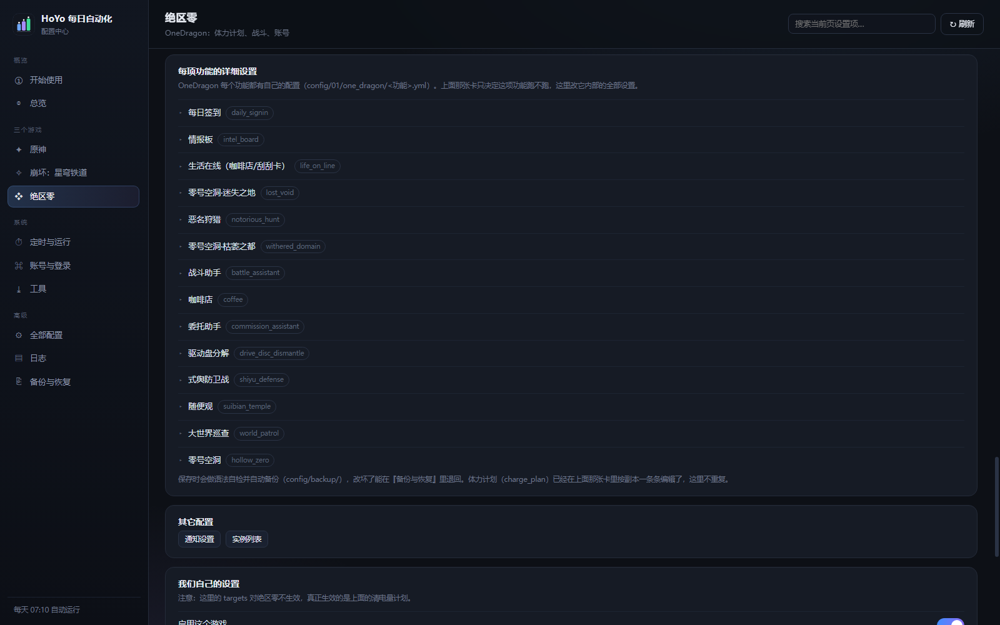

### 兜底：文件里有的每一个键都能改

每个游戏页最后还有「全部设置」折叠区，「全部配置」页可以直接改原文；上游默认值（`config.example.yaml` / OneDragon 源码）
会以淡色补全显示，**文件本身保持稀疏**，不会把你没改过的默认值写死进去。

> 配置文件里有密码（`config/accounts.yaml`、OneDragon 的 `game_account.yml`），界面里一律打码显示。
> `config/accounts.yaml`、`config/daily_config.yaml`、`config/display_user.json` 都在 `.gitignore` 里，不会进仓库。

### 帮助与排查：路径、日志、上游文档，一键打开

「不知道该看哪个文件」是本项目里最常见的问题。侧栏最后一页 **帮助与排查** 把这些全列出来，点「打开」就直接定位：

| 卡片 | 里面有什么 |
| --- | --- |
| 遇到问题先做这三步 | 先看总控日志 → 再看对应引擎今天的日志 → 最后才去上游提 issue（附日志比附截图有用） |
| 原神 · BetterGI | 一条龙任务 `User\OneDragon\daily.json`、主设置 `User\config.json`、战斗策略目录 `User\AutoFight`、日志 `log\`、**游戏自己的日志** `LocalLow\miHoYo\原神\output_log.txt` |
| 崩坏：星穹铁道 · 三月七助手 | `config.yaml`、带全部中文注释的 `assets\config\config.example.yaml`、`logs\YYYY-MM-DD.log`、游戏日志 `Player.log` |
| 绝区零 · OneDragon | `config\01`（game / game_account / notify）、`config\01\one_dragon\*.yml`、`config\auto_battle`、日志 **`.log\log.txt`**（不是 `logs\`）、自带 `docs\运维指南` |
| 本项目（胶水层） | `logs\daily.log`、`logs\zzz_cli.log`、`logs\config_changes.log`、`logs\login\`（登录失败截图）、`config\backup`、`config\daily_config.yaml` |
| 常见问题速查 | 8 条最常见的故障：今天没跑 / 原神站着挨打 / 掉登录 / 崩铁不退出 / 绝区零没画面 / 下载更新失败 / 分辨率不是 16:9 / 改了配置没生效，每条都直接给「点哪个文件」「搜哪个关键词」「看哪篇上游文档」 |
| 关于本项目 | 仓库地址、Star、Issues、最新 Release |

- 路径都是**现读磁盘**的：文件不存在会直接标灰，不会给你一条死链。相对路径按安装目录显示，同时显示大小和修改时间。
- 打开方式：目录用资源管理器打开，文件直接 `explorer /select` 定位并选中；只能打开安装目录和游戏 `LocalLow` 目录下的路径（写了越界路径会被拒绝）。
- 三个游戏页底部各有一条「文件在哪、日志在哪」折叠条，只列这个游戏相关的，不用再翻到帮助页。

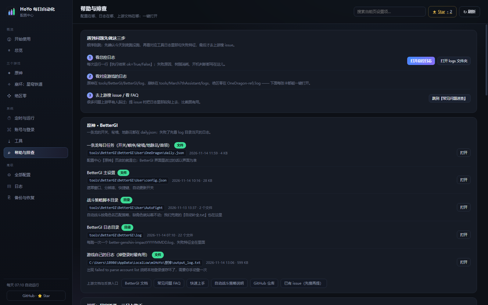

### Star 一下

顶栏右上角有 `★ Star`（带实时 star 数，来自 GitHub API），侧栏底部也有一个入口；点开会跳到仓库，页面里再点一次 Star 就收藏完了——**这个项目没人知道，star 是目前唯一能让别人搜到它的信号**。

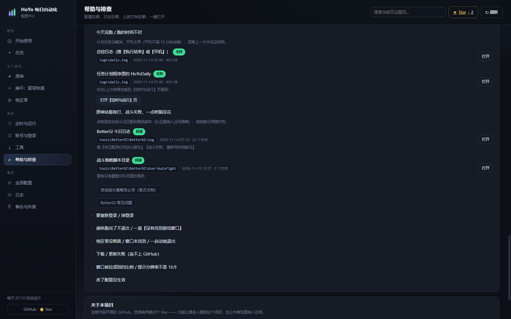

## 配置（`config/daily_config.yaml`）

- `scheduler`：运行顺序、总超时。
- `games.<游戏>.enabled`：是否参与每日流程。
- `games.<游戏>.targets`：要刷的本/秘境，每项可单独 `enabled`、`runs`（`0` 表示清空体力）。
- `games.<游戏>.display.auto_switch_window`：跑之前自动切成窗口化 1920×1080，跑完恢复你原来的设置。
- 首次运行会自动从 `config/daily_config.example.yaml` 生成一份默认配置。

示例（原神）:

```yaml
games:
  genshin:
    enabled: true
    party_name: "你的队伍名"   # 打秘境用的队伍
    targets:
      - { name: "山风的荆冕", runs: 0, enabled: true }
```

## 定时任务（无人值守的关键）

配置中心「定时与运行」保存时间时会用 PowerShell 注册一个名为 `HoYoDaily` 的计划任务：

- 触发器：每天 `HH:MM`；`StartWhenAvailable=True`（开机晚了/错过了也会补跑）。
- 主体：`RunLevel=Highest` + `LogonType=Interactive`——**子进程继承最高权限**，所以引擎自己再启动游戏时不会再弹 UAC。
- 动作：`pythonw.exe auto_daily.py`（无窗口，不会突然弹黑框）。
- 互斥：`MultipleInstances=IgnoreNew`；程序内部还有单实例锁，避免重复启动引擎。

> 注意：如果你自己手动（非计划任务）运行 `auto_daily.py`，因为拿不到最高权限，启动引擎时可能弹一次 UAC —— 这是正常的。

## 谁说了算（配置优先级）

**结论：BetterGI 界面 > `config/daily_config.yaml`。** 你在界面里改的东西，程序不会去覆盖；
只有本文件**显式声明**的才由程序写进一条龙配置：

| 设置 | 谁说了算 |
|---|---|
| 队伍名、默认秘境、每周秘境、地脉花的星期/国家、尘歌壶买什么、树脂策略、日常四项开关… | **BetterGI 界面**（程序不碰） |
| 圣遗物本 / 地脉花"哪天开"（target 的 `days`） | `daily_config.yaml`（按天轮换规则） |
| 额外任务开关（幽境危战 / 地脉花 / 首领讨伐） | 配置里写 `enabled: true/false` → 程序控制；写 `enabled: ui`（推荐）或不写 → **听界面** |

> 曾经反着来过（适配器每次把 `DomainName`、`PartyName`、7 个任务开关全部覆写，界面里改了也没用）——
> 2026-10-10 按用户要求改成"界面优先"，并且只在配置显式声明时才写。

## 屏幕模式自动切换（含"自愈"）

游戏按窗口客户区大小渲染，识别类引擎在 16:9 窗口化下最稳，所以每款游戏开跑前会自动切成 1920×1080 窗口化，
跑完再恢复成你自己的设置（例如 2560×1600 全屏）。这里有两个**必须遵守**的细节，否则会出现"第二天自己开游戏变窗口"的怪事：

1. **先杀游戏、等它彻底退出，再写回设置**。Unity 游戏在退出瞬间会把自己的显示设置回写注册表，
   先恢复再杀进程的话，那次恢复会被游戏覆盖掉。
2. **用户设置要单独存档**（`config/display_user.json`）。只靠"跑之前快照 → 跑完恢复"不够：
   一旦某次快照本身已经是残留的窗口化，之后就会把这个窗口化一路传下去，永久污染。
   所以只有当快照看起来不是自动化状态（1920×1080 窗口化）时才更新档案；恢复时若发现当前状态是残留，就改用档案。

3. **兜底（`win_guard.py`）**：万一客户端就是不认注册表，引擎跑起来后它会**整场盯着**游戏窗口，
   只要发现客户区不是 16:9（比如 2560×1600 全屏 16:10）就拉成 1920×1080，后面再变还会再拉回来；
   三个引擎都挂了这道保险。
   注意：光靠它是**不够**的（见下面绝区零那条）—— 绝区零的窗口受保护，实测连拉 10 次都拉不动。

### 绝区零特有：换"显示档"（2026-09-13 实测结论）

绝区零把显示模式存在**它自己的一份存档**里（`ZenlessZoneZero_Data\Persistent\LocalStorage\GENERAL_DATA.bin`），
启动约 8 秒后用它覆盖注册表。只改注册表没用：游戏先按注册表以 1920×1080 窗口起来，
随即自己切回 2560×1600 全屏（16:10），OneDragon 在 16:10 下识别全废（邮件/签到/体力刷本全失败），
而它的窗口受保护、外部改不动大小 —— 这是三款游戏里唯一同时占这两条的。

解决办法是**换档**：把"用户自己的显示档"和"自动化用的窗口档"分别存成快照，跑之前换窗口档、跑完换回用户档。

```bat
rem 让游戏自己生成窗口档：游戏内改成"窗口 1920x1080"后执行（此时游戏必须是关的）
mkdir config\zzz_display_profiles\windowed
copy "D:\ZenlessZoneZero Game\ZenlessZoneZero_Data\Persistent\LocalStorage\*.bin" config\zzz_display_profiles\windowed\
.venv\Scripts\python.exe display_mode.py zzz show-user > config\zzz_display_profiles\registry_windowed.json
```

跑的时候适配器会自动：`windowed` 档（3 个存档文件 + 注册表）→ 跑完 `fullscreen` 档。
这两份档含个人存档数据，**已在 `.gitignore` 里排除，不会进仓库**。

被污染了也不怕，一条命令修回来（游戏正开着会等它退出后再改）：

```bat
.venv\Scripts\python.exe display_mode.py zzz fix-user 2560 1600 --wait
.venv\Scripts\python.exe display_mode.py starrail show-user
```

## 环境变量（可选，用于自定义路径）

| 变量 | 作用 |
|---|---|
| `HOYO_BETTERGI_DIR` | BetterGI 安装目录 |
| `HOYO_MARCH7TH_DIR` | March7thAssistant 安装目录 |
| `HOYO_ONEDRAGON_DIR` | OneDragon 目录 |
| `HOYO_PROXY` | 下载/更新走代理时使用，如 `http://127.0.0.1:7890` |

## 踩坑记录（血泪，帮你少走弯路）

1. **绝区零的 OneDragon 必须用前台模式**（`background_mode: false`）。后台模式点击登录页会失败；前台模式才稳。
2. **窗口受保护**：游戏窗口对非管理员进程的 `PostMessage`/`taskkill` 会被拒绝（错误 5），所以引擎必须在管理员上下文里跑——这就是计划任务要用最高权限的原因。
3. **不要用后台模式 + 虚拟手柄去点登录页**，那是错的方向：前台 + 正常鼠标模拟就够了。
4. **屏幕模式**：游戏按窗口客户区大小渲染，跑之前统一切成 1920×1080 窗口化，跑完恢复原设置，能显著减少识别失败。
5. **配置文件写入**：不要用 PowerShell `Set-Content -Encoding utf8` 写 YAML（会带 BOM，ruamel/PyYAML 解析报错），用 Python 以 UTF-8 无 BOM 写。
6. **路径**：在生成的配置文件/脚本里统一用正斜杠 `/`，避免反斜杠被各层转义吃掉（`D:daily...` 这类事故）。
7. **实时日志**：引擎日志可能很大，判断"跑完没跑完"时只读文件尾部（例如最后 300KB），不要整文件读入。
8. **屏幕设置的两个坑**（见上一节）：恢复必须放在"游戏进程完全退出"之后；用户设置要独立存档，否则一次窗口化残留会永久传染。
10. **绝区零的显示模式存在它自己的存档里**（`LocalStorage\GENERAL_DATA.bin`），启动 8 秒后覆盖注册表；
    它的窗口还受保护、拉不动。只能"换档"（见上），改注册表/SetWindowPos 都白费。
11. **OneDragon 进程退出 ≠ 成功**：它识别失败后会自己中止（实测退出码 `0xC000013A`），
    所以 `wait()` 必须看退出码，否则会把失败报成成功。
12. **BetterGI 不要无脑跟最新版**（走过的路）：
    - `0.65.0`＝上游重构版（发布说明自己写着"版本BUG较多"）→ 自动秘境「识别出战角色失败 → 卡墙角 → 后续任务全被挡」，9/19–9/20 连挂两天；
    - 退回 `0.64.0` 稳定，但它的**地脉花国家列表里没有"至冬"**（7.x 新地区）→ 地脉花每天直接失败（`冒险之证未找到国家: 至冬`）；
    - `0.66.0`＝地脉花配置换成新键 `leyLinePositions` 且**含"至冬"**，说明里也修了自动战斗相关问题 → 曾固定用它；
    - `0.67.0`（2026-11-09）＝对比 0.66.0 全量覆盖后实测一条龙能跑完（任务名/CLI 参数/配置键都没变），
      现在 **跟最新版**（`tools_manager.py` 的 `"tag": ""`），并且把 BetterGI **自己的自动更新也开着**
      （删掉 `BetterGI.update.exe.disabled`、`runForVersion` 同步到当前版本）。
      升级前记得：包内 `User/` 只有资源文件，覆盖不会动用户配置；覆盖前仍会先备份 `User/`。
15. **额外任务（幽境危战 / 地脉花 / 首领讨伐）的开关看配置**：`config/daily_config.yaml` 里 targets 中
    名字含"幽境""地脉""首领"的条目，`enabled: true/false` 直接决定 BetterGI 一条龙里对应任务开不开。
    曾经把幽境危战写死成"跟随某个 target 的 auto_stygian"，结果永远关着（每天被跳过）。
17. **每个 target 可以配 `days` 做按天轮换**，例如「周一~周四打地脉花、周五~周日打圣遗物」：
    ```yaml
    targets:
      - { name: "逆悬的冰河", runs: 0, enabled: true, days: "周五~周日" }
      - { name: "地脉花",   enabled: true, switch_only: true, days: "周一~周四" }
      - { name: "幽境危战", enabled: true, switch_only: true }   # 活动开着就打
    ```
    支持 `"周五~周日"` / `["Friday","周六"]` / `"5-6"` 三种写法；不配 = 每天。
18. **适配器会覆写 `DomainName`**（秘境名取自 target 的 `name`）—— 所以在 BetterGI 界面里改秘境是没用的，
    要改就改 `daily_config.yaml`。若界面里开了"每周秘境"且**当天**配了秘境，则以界面那套为准（会写日志）。
16. **地脉花按"星期X + 国家"配置**，国家必须在当前 BetterGI 版本支持列表里（读
    `GameTask/AutoLeyLineOutcrop/Assets/config.json`，0.66 的键是 `leyLinePositions`），否则任务直接失败。
13. **BetterGI 内部失败不反映在退出码上**：进程照样正常退出，只看退出码会一直显示 `ok=True`。
    所以跑完必须扫日志特征（`游戏窗口分辨率不是 16:9` / `识别出战角色失败` / `任务启动失败` / `执行异常`），
    命中就在主日志里报 WARNING —— 已在 `adapters/bettergi.py` 里实现。
14. **日志目录是包根的 `log/`**（不是 `User/log`）。判定完成标记/失败特征时只认"本次运行之后新增的内容"
    （启动时记日志基线），否则会把上一次运行的结果误当成这次的。
9. **BetterGI 一条龙的任务开关是 GUID 键**（`TaskDefinitions` 是 `{GUID: 任务名}`）。按中文名写开关会被它自己已保存的状态整体覆盖，等于没配 —— 必须先反查 GUID 再写。

## 日志判定的三层（不是"退出码 0 就算成功"）

上游引擎内部任务失败时**进程照样正常退出**，所以光看退出码会一直是 `ok=True`。适配器把日志特征分成三层：

| 层级 | 特征举例 | 处理 |
|---|---|---|
| **判失败** | `执行失败`、`已达最大重试次数`、`任务启动失败`、`识别出战角色失败`、`未匹配到任何战斗脚本`、`游戏窗口分辨率不是 16:9`、`任务被取消` | 本次 `ok=False` + ERROR |
| **软告警**（可能少刷了，但不判死） | `放弃此路径点`、`距离过远`、`未完整匹配到当前队伍`、`存在角色死亡`、`战斗失败，重新寻找地脉花` | WARNING，让退化在 `daily.log` 里显形 |
| **预期内**（不判失败） | 领奖页明确说树脂不够（`奖励页面树脂识别结果未匹配成功` + `今日还可使用`）且本次确实花过树脂 | WARNING + 把领奖页 OCR 原文写进日志，一眼分辨"没钱了"还是"认不出弹窗" |

另外每次运行都会在 `daily.log` 记一行**树脂账**（`本次树脂消耗: 140（4 次领取: 40+40+40+20）`），
不用再翻引擎日志数。崩铁适配器同理，会记录开拓力起止与"未完成/跳过"特征。

绝区零（OneDragon）再多一层区分，因为它的"抖动"特别多（开局检测窗口时偶尔截不到图）：

| 类别 | 特征 | 处理 |
|---|---|---|
| **真失败** | `暂停启动`、`未配置账号密码`、`返回状态 异常` | 直接 `ok=False`，不看别的 |
| **抖动** | `未获取到游戏截图`（≤5 次）、`游戏窗口未找到`（≤5 次）、`执行出错`（≤10 次） | 只要最终跑到「全部结束」就按成功处理，仅 WARNING |
| **没跑完** | 没有「全部结束」，或抖动次数超过上限 | `ok=False` |

## 自愈与防护（2026-11-13 加固）

下面这些都是一轮轮真跑炸出来的，处理原则一致：**不 fork、不改上游，只在我们这层兜住**。

### ① 原神"站着挨打" → 战斗脚本自动补全

BetterGI 按"队伍角色与脚本角色重合最多"挑战斗脚本，一个都对不上就抛 `未匹配到任何战斗脚本`，
AutoFight 一次按键都不发 —— 游戏里看到的就是角色站着被打死。而安装目录里通常只有一份很旧的群友脚本，
新角色（桑多涅 / 薇斯纳 / 尼可 …）它根本不认识。

适配器现在会在收尾时读本次日志里的 `识别到的队伍角色:"A,B,C,D"`，把脚本里**没有的名字**追加到
`User/AutoFight/自动补全.txt`（我们自己的文件，**不改动任何人原有的脚本**），每行一条通用连招：

```text
桑多涅 e, attack(0.3), check, wait(0.3), keypress(q), wait(0.1), ready, check, wait(0.3)
```

并且这趟如果命中 `未匹配到任何战斗脚本`、又确实补进了新角色，会**自动重跑一趟** —— 补完就能打，
不用等到第二天。历史日志回放验证：8 个出现过的队伍角色里，旧脚本缺的正好就那 4 个，其余 42 个都已覆盖。

### ② 引擎早早收工 → 判失败 + 重试

BetterGI 偶尔在"启动游戏"阶段就自己退出：日志里只有 `启用任务总数量: N`，没有 `遮罩窗口已启动`，
也没有完成标记 `一条龙和配置组任务结束`，但**退出码是 0**。现在：跑完没有完成标记 = 失败；
耗时 < 2 分钟就退 = 失败。两种情况都杀干净引擎和游戏、隔 15 秒重跑一趟（等文件锁和引擎状态释放）。

### ③ 绝区零：退出码 0 也可能是空跑

2026-11-13 实测：OneDragon 因为 `未获取到游戏截图` / `游戏窗口未找到` 整条龙没跑，`code=0`，38 秒就退出，
而我们照旧报了 `ok=True`（假成功）。现在按 `logs/zzz_cli.log` 判定：必须跑到 `执行成功 返回状态 全部结束`，
且不含 `未获取到游戏截图` / `执行出错` / `暂停启动` / `未配置账号密码`；3 分钟内失败的还会自动重试一次
（重铺窗口档 + 重启游戏）。

### ④ 绝区零的账号档不能当显示档拷（频繁掉登录的元凶）

`ZenlessZoneZero_Data\Persistent\LocalStorage` 里除了显示设置 `GENERAL_DATA.bin`，还躺着 `USD_*.bin`
（账号 / UID 的本地存储）。早期换档逻辑把整个目录的 `*.bin` 一起拷，于是**每次跑都把旧账号档写回游戏** ——
表现就是"几乎每天都要求重新登录"。现在只搬 `GENERAL_DATA.bin`，`USD_` 前缀一律跳过。

### ⑤ 关游戏先温和、后硬杀

`taskkill /IM <exe>`（不带 `/F`，等于发 WM_CLOSE）→ 等 8 秒 → 还在才 `/F`。硬杀会让游戏来不及回写
登录态和配置，是"频繁掉登录"的帮凶之一。

### ⑥ 崩铁：跑之前先收掉在跑的游戏实例

`StarRail.exe` 若已经在跑（比如你正开着全屏玩），三月七拉窗口必然失败
（`游戏分辨率: 2560x1600，请在游戏设置内手动切换为 1920x1080 窗口`）。现在启动前先温和关闭已有实例。
另外 `账号登录过期` 是**引擎替不了**的事（三月七配置里没有账号/密码字段），现在会立刻判死并给出提示，
不再空转到把后面的绝区零挤掉 —— 真掉登录时由下一节的登录兜底自动填账号密码；万一自动登录失败，
日志会提示你手动开一次游戏登录、勾上"记住我"。

## 登录兜底：掉登录时自动用**账号密码**登录（绝不用手机验证码）

米哈游三款游戏的登录态都存在游戏本地，缓存一坏就得重新登录。三家引擎里只有 OneDragon 原生会登录；
另外两家（BetterGI / 三月七）遇到登录界面只会干等 —— BetterGI 甚至会自己把游戏杀掉重开
（2026-11-09 就是这么白跑一趟、树脂 0 消耗）。所以本项目自带一层登录兜底：

| 游戏 | 谁去登录 | 做法 |
|---|---|---|
| 原神 | `login_helper.py` | 后台线程盯 `YuanShen.exe` 窗口 → OCR 认出登录界面 → 点「账号密码登录」→ 填账号/密码 → 点登录 → 等登录界面消失 |
| 崩铁 | `login_helper.py` | 同上（盯 `StarRail.exe`） |
| 绝区零 | OneDragon 原生 | 把账号密码写进它自己的 `config/01/game_account.yml`，它就选「国服-账号密码登录」（`enter_game.py` 的 `check_login_related` / `input_account_password`） |

### 账号密码放哪（不进仓库）

```yaml
# config/accounts.yaml —— .gitignore 已排除；里面是明文密码，不要提交、不要外传、不要贴进截图
genshin:
  account: "你的手机号"
  password: "你的密码"
starrail:
  account: "..."
  password: "..."
zzz:
  account: "..."
  password: "..."
```

关掉某款游戏的自动登录：在该游戏段落里写 `auto_login: false`。

### 怎么认准登录界面（不依赖任何固定坐标）

- 截客户区 → `ocr_helper.py`（**复用 OneDragon 自带的 onnxocr + ppocrv6 模型**，常驻子进程，
  第一张约 2 秒、之后 1~2 秒/次）→ 返回每个文字的框坐标。
- 靠**文字**判断：`账号密码登录` / `请输入账号` / `请输入密码` / `登录`；一旦看到 `手机验证码`
  立即停手并报「需要手机验证码（按要求不做）」。
- **闭环校验**（关键）：账号粘贴后必须 OCR 看到那串数字**落在账号框的 y 范围里**才算填对；
  落错框就点进去清空重填（最多 3 次）。密码是圆点，用"占位提示消失"作为填入证据。
  第一版就是因为"点一下再粘贴"存在焦点竞态，账号跑进了密码框 —— 所以不能点完就假定焦点在里面。
- 一次运行**最多提交一次**账号密码（避免把账号打进风控）；失败只记日志 + 截图，不反复重试。
- 每步截图存 `logs/login/<game>_<时间>_*.png`（探测 / 填账号后 / 填密码后 / 等待结果）；
  `logs/daily.log` 里 `[login]` 开头的行会记录过程，**账号一律打码成 `189******80`**。

### 掉登录这件事：2026-11-24 的最新结论

- 本地「记住的账号」在 `HKCU\\Software\\miHoYo\\<游戏>\\MIHOYOSDK_ADL_0`（REG_BINARY，内容是 base64 密文），
  三款还要共用 `HKCU\\Software\\miHoYoSDK` 里的设备钥匙。**多游戏共存时这份记录会被写坏**
  （米哈游客服对「PC端无法保存登录记录」给的办法也是删掉让它重写，社区也有大量原神/星铁互踢的反馈）。
- 记录一坏，游戏启动时**不会去试 token**，直接弹密码页；而且它**不会自己好** —— 所以以前记录坏了就等于当天白跑。
- 现在的处理顺序（`auto_daily.run_game()` 里，引擎启动之前）：

  | 步骤 | 做什么 | 失败时 |
  |---|---|---|
  | 1. `adl_guard` | 健康就留快照；太长（≥1800 字符）换回 ≤1600 的小快照；已被写成 24 字节空值/缺失 → **只删 `MIHOYOSDK_ADL*` 这两个值**（先备份原值），标记「需要登录」 | 打 WARNING，照旧继续 |
  | 2. `rescue_login()` | 需要时自己拉起游戏 → OCR 找登录框 → 填账号密码 → **只点协议圆圈** → 点「进入游戏」 → **以「记录真的写回 >100 字节」为成功标准** → 优雅关游戏 | 打 ERROR「需要你手动登录一次」，不影响后面两款 |
  | 3. 正常跑 | 记录已修好，交给 BetterGI / 三月七按常规流程跑 | — |

  绝区零跳过第 2 步：OneDragon 自带账号密码登录（实测记录被清后 10 秒自己就登回去了）。
- 运行期间的兜底 `watch()`：每 3 秒比对一次记录，一变就 WARNING「掉登录的时刻就是现在」并抢一次前台截图；
  抢不到也每 60 秒说一句「游戏窗口不在前台（已跳过 N 轮）」，**不会再静默**。
- 想自己看记录状态：`.venv\\Scripts\\python.exe adl_guard.py status`；`logs/adl_state.log` 里每趟前后都有一行
  （含三款的长度+哈希，和共享设备钥匙指纹 `sdk.device_id=… seed_id=…`）。
- 逐日复盘（11-16 ~ 11-24，含每次的日志证据、假件验证、当时推翻的旧结论）在 **[docs/INCIDENTS.md](docs/INCIDENTS.md)**。

## 本地补丁（可选）：把 BetterGI 的两个坑从源码层面修掉

有些问题在上游引擎里，改配置绕不过去。本项目提供一份**针对上游源码的最小补丁**（不是 fork，不需要长期维护）：

```
patches/bettergi-local-fixes.patch      # git diff 生成，基于上游 0.66.2-alpha.2（commit 704d920）
```

修的两处：

1. **地脉花寻路失败不再整任务挂掉**（`AutoLeyLineOutcropTask.RunLeyLineChallenges`）：
   某朵花走不到时（`目标距离过远` / `当前点位无法被识别` / 重试耗尽），记日志→回主界面→**去找下一朵**，
   连续失败 3 次才真的放弃。原版是一次失败就把整个地脉花任务干掉（2026-10-14 至冬只打了 2 朵、树脂只花 80）。
2. **读树脂不再"读不到就当 0"**（`CountOriginalResin` / `CalCountByResin`）：
   最多等 10 秒、每秒重试；图标出现后 OCR 再重试 3 次；实在读不到返回 `-1`（=读不到），
   上层回退用配置次数继续跑，不再判"树脂耗尽"（2026-10-13 整天 0 树脂就是这么来的）。

自己编译（需要 .NET 8 SDK，**不需要管理员**）：

```bat
rem 1) 装 SDK 到任意目录（官方脚本，用户级安装）
powershell -c "Invoke-WebRequest https://dot.net/v1/dotnet-install.ps1 -OutFile %TEMP%\dotnet-install.ps1"
powershell -c "%TEMP%\dotnet-install.ps1 -Channel 8.0 -InstallDir D:\dotnet -NoPath"

rem 2) 取上游源码 + 打补丁
git clone --depth 1 https://github.com/babalae/better-genshin-impact.git D:\BetterGI-src
cd /d D:\BetterGI-src && git apply /path/to/patches/bettergi-local-fixes.patch

rem 3) 编译到独立目录（不覆盖正在用的安装）
D:\dotnet\dotnet.exe build BetterGenshinImpact\BetterGenshinImpact.csproj -c Release -o D:\BetterGI-patched
```

> 上游是 **GPL-3.0**：自己改了自用没问题；**若分发修改版必须公开对应源码**并注明基于哪个 commit。
> 本补丁只改了 1 个文件（+68/−15 行），随时可以对照上游最新代码重做，不必维护长期 fork。

## 风险与免责

- 使用第三方工具模拟操作**违背游戏用户协议，存在封号风险**，请自行评估；本项目不对此负责。
- 运行时游戏窗口需保持前台、屏幕常亮、不要手动操作电脑；不要开画面滤镜（HDR/显卡滤镜），亮度保持默认。
- 本项目为个人自用工具，按 MIT 许可证发布，不提供任何担保。三款游戏的名称、素材、商标归米哈游所有。

## 许可证

MIT（见 LICENSE）。上游三个引擎各自遵循其仓库中的许可证，版权归其作者所有。